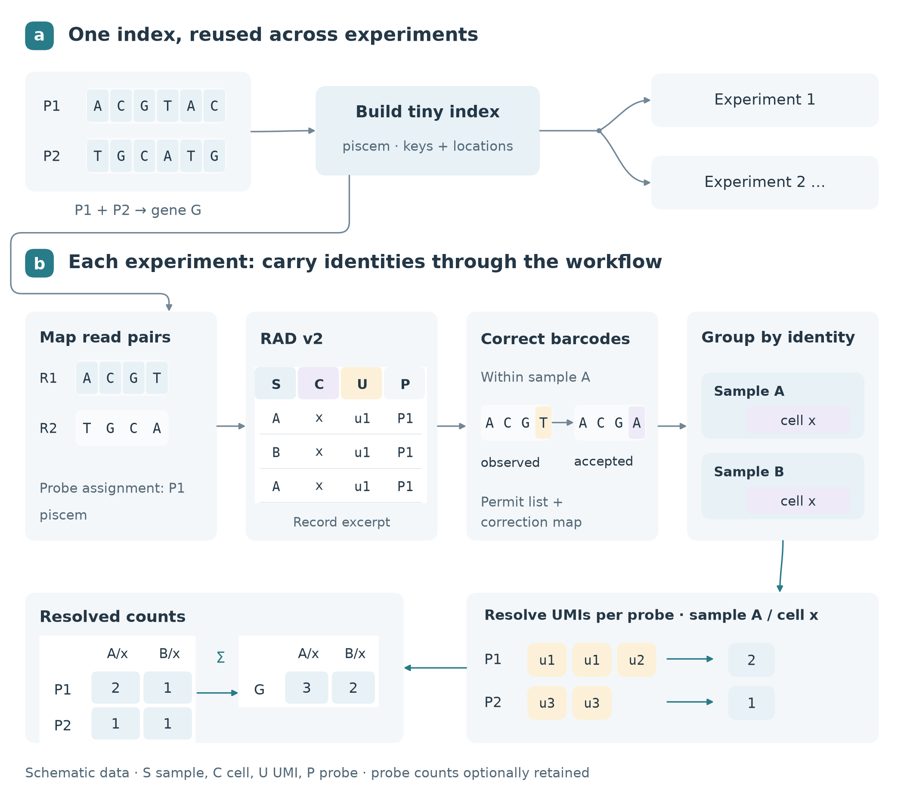

# Scientific Diagrams

A reusable agent skill for making scientific-paper diagrams more visually pleasing
while preserving their technical content. It adapts the planning workflow of
[Jim Liu's baoyu-article-illustrator](https://github.com/JimLiu/baoyu-skills/tree/1567581c26ec29f4216c6e6835415bf30343b0e3/skills/baoyu-article-illustrator)
into a separate deterministic vector workflow.

The main contribution is a visual-design process: softer enclosures, clearer
hierarchy, restrained typography and color, more whitespace, and continuous curves
attached to named ports and shared junctions. It supports aesthetic polishing of
existing figures as well as new diagram design. The source remains editable.



## Contents

- [`skills/scientific-diagrams/SKILL.md`](skills/scientific-diagrams/SKILL.md): portable entrypoint.
- Visual design, manuscript planning, domain semantics, backend/QA guidance, and
  the upstream integration boundary under `references/`.
- A small Python/Matplotlib vector vocabulary: sequences, records, nested identities,
  UMIs, matrices, Bloom bits, packed fields, segment/exon tracks, and attached curves.
- Three original, schematic RECOMB2027-informed examples under
  [`examples/recomb2027/`](examples/recomb2027/figure-brief.md).
- Tests for scientific invariants, rendering contracts, deterministic exports, and
  archive integrity; local packaging and CI.

The examples demonstrate a visual treatment using expanded canvases and some
simplifications. They are not content-identical replacement manuscript figures.
No manuscript text, source drawing code, data, screenshots, or PDF is redistributed.
An actual paper revision still needs final-height fitting and a manuscript build.

## Use and reproduce

The skill directory is self-contained. An archive build contains exactly one
`scientific-diagrams/` root with `SKILL.md`, references, helper code, toy data,
license notices, and a file-hash manifest. Use it in an environment that supports
skill archives or filesystem skills. Python execution and dependencies are needed
for the bundled renderer; instructions and existing-backend polishing can still
be used without it. This repository does not install itself or alter preferences.

```sh
python3 -m venv .venv
.venv/bin/pip install -r requirements-lock.txt
.venv/bin/python skills/scientific-diagrams/scripts/build_examples.py --out dist/examples
.venv/bin/python skills/scientific-diagrams/scripts/check_exports.py dist/examples
.venv/bin/python -m unittest discover -s tests -v
.venv/bin/python tools/package_skill.py
```

Download the packaged skill from [`skill.zip`](skill.zip), with checksum in
[`skill.zip.sha256`](skill.zip.sha256). A fresh build writes `dist/skill.zip`. `requirements.txt` gives broader supported
versions; the lock records the validated export environment. Optional Graphviz
and TikZ workflows are documented, not implemented exporter switches. The primary
renderer requires neither TeX nor an image-generation service.

Example requests:

> Use scientific-diagrams to polish this figure. Keep the content and panel
> structure; soften the boxes, improve spacing, and fix disconnected arrows.

> Show how reads become probe-level UMI counts and then gene counts. Preserve
> sample–cell identities and label toy data as schematic. Deliver SVG and PDF.

## Validation and limits

See [`docs/VALIDATION.md`](docs/VALIDATION.md). Automatic checks cover extent,
overlap, identity/count invariants, hashes, and connection contracts. Visual review
is separate and required; the renderer is not an automatic aesthetic optimizer,
obstacle router, or scientific validator. It keeps live SVG text and embeds PDF
fonts. Exact byte reproduction is scoped to the same environment.

## Provenance and publishing

The repository uses BSD 3-Clause, preserving its initial license. The packaged
`scientific-diagrams` skill is MIT licensed, with upstream copyright and permission
notice retained; its own `LICENSE` governs that subtree. See
[`THIRD_PARTY_NOTICES.md`](skills/scientific-diagrams/THIRD_PARTY_NOTICES.md) and
[`upstream.json`](skills/scientific-diagrams/upstream.json) for the inspected
revision, hashes, and adaptation boundaries. No upstream runtime dependency is
required. New example code is original; private manuscript evidence is summarized
and fingerprinted, not copied into the repository.

The repository remote is
[rob-p/technical-figure-skills](https://github.com/rob-p/technical-figure-skills),
with development on `main`. Its initial commit and repository-level BSD license
are preserved. For updates, regenerate and validate the archive before replacing
the downloadable `skill.zip` and its checksum.
